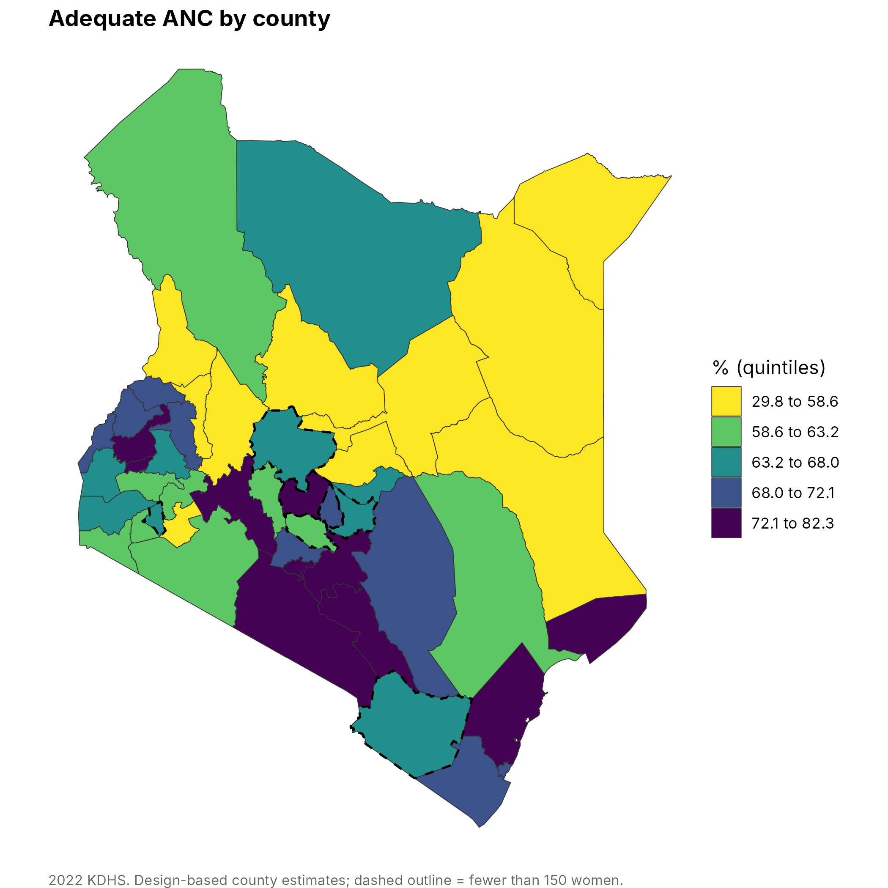
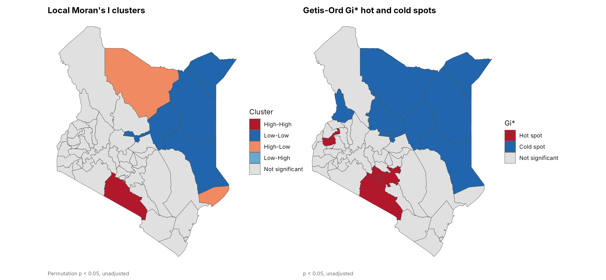
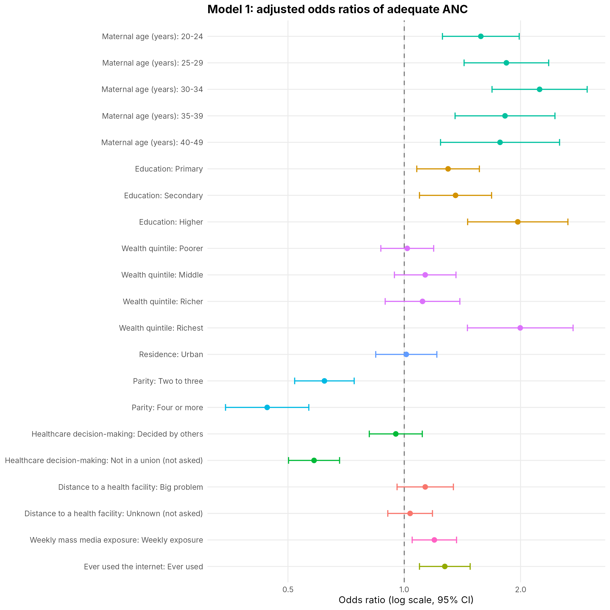

# kdhs-anc-multilevel

Survey-weighted, multilevel and spatial analysis of antenatal care (ANC) in the Kenya Demographic and Health Survey (KDHS), written in R as reproducible notebooks.

**Author:** Briton M Kavulavu

The workflow was developed on the 2022 KDHS Women's Individual Recode, with adequate ANC (four or more visits) as the main outcome and optimal ANC (eight or more visits) as the second. It is driven by one configuration file, so the same notebooks can be rerun on another KDHS round, or another DHS country, by editing the configuration rather than the code.



## What it does

| Notebook | Content |
|---|---|
| `01_data_preparation` | Reads the DHS file, builds analysis variables, sample flow, missing data and structural missingness, sample characteristics |
| `02_descriptive_bivariate` | Design-based percentages with logit confidence intervals, crude odds ratios, Cramer's V, gradients, timing of first visit, slope and relative indices of inequality, concentration index with cluster bootstrap |
| `03_survey_logistic` | Survey-weighted logistic regression (`survey::svyglm`), forest plot, Nagelkerke R², Hosmer and Lemeshow, AUC, collinearity, calibration, standardised predictions, optimal ANC and early-booking models |
| `04_multilevel_models` | Two-level random-intercept logistic models (`lme4`), intraclass correlation, median odds ratio, proportional change in variance, likelihood ratio test, quadrature check, county effects |
| `05_spatial_epidemiology` | County estimates, neighbours, global Moran's I, local Moran's I (LISA), Getis-Ord Gi\*, empirical Bayes smoothing, Moran's I of county random effects, exploratory spatial lag and error models |
| `06_maps` | Static choropleth, smoothed, precision, cluster, hot-spot and random-effect maps, and a layered interactive `leaflet` map |
| `07_sensitivity_checks` | Complete-case analysis, alternative thresholds, leave-one-county-out, weighted versus unweighted, design effects, residual spatial dependence |

Each notebook saves tables (CSV) to `outputs/tables`, figures (PNG and PDF) to `outputs/figures`, the interactive map to `outputs/maps` and an HTML report to `outputs/reports`.

| | |
|---|---|
|  |  |

## Quick start

1. Install R (4.2 or later) and the packages: `source("scripts/install_packages.R")`.
2. Get the data (see `data/README.md`) and county boundaries (see `data/boundaries/README.md`).
3. Open `kdhs-anc-multilevel.Rproj` in RStudio and edit `config/config.yml` (file paths at least).
4. Run everything: `Rscript scripts/run_pipeline.R`, or knit the notebooks one by one in order. Run a subset with `Rscript scripts/run_pipeline.R 05 06`.

No DHS data? Test the pipeline on synthetic data: `Rscript tests/smoke_test.R`. The synthetic numbers mean nothing; the test only checks that the code runs end to end.

Paths can also be set with environment variables: `KDHS_CONFIG`, `KDHS_DATA`, `KDHS_BOUNDARIES`, `KDHS_OUTPUT`.

## Using another KDHS round (or another DHS survey)

1. Copy `config/config.yml` to `config/config_kdhs2014.yml` and point `KDHS_CONFIG` to it.
2. Change `paths.data_file`, `paths.boundaries_file`, `project.survey_label`.
3. Check the variable mapping. DHS-7 (2014) and DHS-8 (2022) share most names. In rounds without `v222` (months since last birth), derive it from `v008 - b3_01` and add the derived column in `R/data_prep.R`, or restrict by `b19_01`; the rule is the one line `eligible <- ...` in `build_analysis_data()`.
4. The geography variable (`v024`) must hold county, province or region labels that match the boundary names; unmatched names stop the run with a list (see `spatial.name_aliases`).
5. Run `scripts/run_pipeline.R`. Covariate category labels live in `build_analysis_data()`; if your round codes a variable differently, change only that block.

## Methods in brief

- **Design.** Weight is `v005 / 1,000,000`, strata `v023`, clusters `v021`, lonely PSUs adjusted. Confidence intervals use the t distribution on the design degrees of freedom.
- **Structural missingness** (decision-making not asked outside a union; distance not asked) is kept as explicit categories, with a complete-case check in notebook 07.
- **Multilevel models are unweighted by default.** `lme4` treats weights as case weights, which is not valid for survey weights, and software that rounds fractional weights drops observations. The survey-weighted model (notebook 03) is the population-level estimate; the multilevel model describes the sample and its county variation. ICC uses the latent-response method, MOR uses 0.6745, the likelihood ratio test is against the single-level null model with the p value halved.
- **Quadrature matters.** A random-intercept variance estimated with too few quadrature points can be wrong. Notebook 04 prints the variance for 1, 5, 10 and 25 points so convergence is visible.
- **Spatial.** Queen contiguity with a nearest-neighbour fallback for counties with no contiguous neighbour. Moran's I and LISA use permutation inference (9,999 by default). Both unadjusted and false-discovery-rate adjusted cluster labels are saved. County estimates carry design-based intervals, and counties with few women are flagged. The spatial regression is ecological and exploratory with 47 units.
- **Hosmer and Lemeshow.** Groups are formed with equal total weight, so the p value can differ from SPSS, which groups differently.

## Example output (2022 KDHS, adequate ANC)

Weighted prevalence 67.4%; null-model county variance 0.223 (ICC 6.3%, MOR 1.57); after adjustment variance 0.139 (ICC 4.0%, MOR 1.43, PCV 37.8%); global Moran's I of county coverage 0.36 (permutation p < 0.001). These come from the code in this repository and require the licensed data to reproduce.

## Repository layout

```
config/config.yml        all settings
R/                       functions (data_prep, descriptives, models, spatial, maps, plots, utils)
notebooks/               seven R Markdown notebooks
scripts/                 run_pipeline.R, install_packages.R
tests/                   synthetic data generator and smoke test
data/                    put DHS data and boundaries here (git-ignored)
docs/img/                example figures
```

## Notes and limitations

- The interactive map needs the `leaflet` package; without it the notebook says so and carries on.
- Associations are cross-sectional and not causal. County-level spatial results describe areas, not individual women.
- ANC is reported for the most recent birth and relies on recall.

## Citation and licence

Cite as in `CITATION.cff`. Code is MIT licensed (see `LICENSE`). DHS data are governed by the DHS Program terms of use and are not included.
